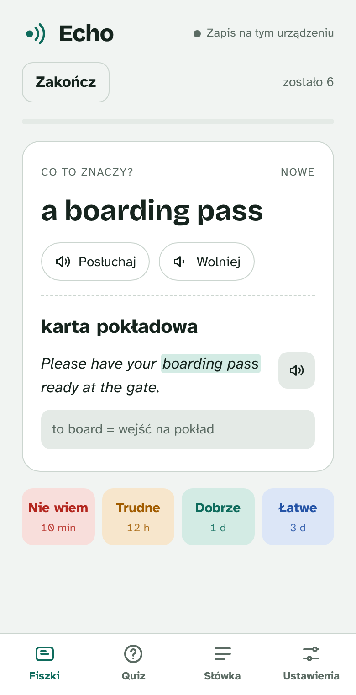

# Echo

Aplikacja do nauki słówek angielskich dla osób mówiących po polsku: fiszki z powtórkami w odstępach, quiz i lektor. Działa w przeglądarce na telefonie i komputerze, bez instalacji i bez konta.

*An English vocabulary trainer for Polish speakers: spaced-repetition flashcards, quizzes and text-to-speech. Single HTML file, no build step, no dependencies. The UI is in Polish.*

<p>
  
  
  
</p>

## Wersja alfa (nowa aplikacja)

W katalogu [`app/`](app/) powstaje nowa wersja Echo: jedna aplikacja na Windows, macOS, Androida i iOS (React + TypeScript + Tauri 2) z dwiema liniami, **Echo** dla dorosłych i **Echo Kids** dla dzieci. Jak jest zbudowana i jakie decyzje czekają na przegląd, opisuje [`docs/architektura.md`](docs/architektura.md).

```sh
cd app
npm install
npm run dev          # przeglądarka, http://localhost:1420
npm test             # testy logiki
npm run tauri dev    # okno desktopowe (wymaga Rust)
```

Aplikacja dołącza talie z katalogu wskazanego przez `ECHO_CONTENT_DIR` (domyślnie [`examples/`](examples/)). Instalator dla Windows i APK dla Androida buduje się ręcznie (macOS i iOS są na razie wyłączone z CI): Actions → **Build** → Run workflow → wybór platformy. Pliki są w artefaktach przebiegu.

Poniżej opis dotychczasowej wersji w jednym pliku `index.html`.

## Co potrafi

- **Fiszki z powtórkami w odstępach.** Najpierw z angielskiego na polski, a po pierwszej udanej powtórce także w drugą stronę. Cztery oceny (Nie wiem, Trudne, Dobrze, Łatwe) i dzienny limit nowych słówek.
- **Quiz** z 10 pytań: wybór tłumaczenia w obie strony, wpisywanie po angielsku z tolerancją literówki i uzupełnianie luki w zdaniu. Błędne odpowiedzi wracają do najbliższej powtórki.
- **Lektor:** systemowy głos przeglądarki, akcent brytyjski lub amerykański i regulowane tempo.
- **Talie słówek wczytywane z pliku lub linku**, a do tego własne słówka dodawane i edytowane w aplikacji.
- **Zapis postępów** w przeglądarce, a w wersji uruchomionej jako artefakt w Claude także na koncie użytkownika.

## Uruchomienie

Otwórz `index.html` w przeglądarce. Wygodniej jest podać katalog przez prosty serwer:

```sh
python3 -m http.server
# http://localhost:8000
```

Na telefonie wybierz w menu przeglądarki „Dodaj do ekranu głównego”, żeby Echo działało jak aplikacja.

## Talie słówek

Echo nie zawiera wbudowanych słówek. Talię wczytuje się w zakładce **Słówka → Talie**:

- **z pliku** `.json` z jedną talią albo z tablicą kilku talii,
- **z linku** do talii albo do spisu talii (`echo-deck-index`). Serwer musi pozwalać na pobieranie z innej domeny (CORS).

Na próbę możesz wczytać [`examples/podroze.json`](examples/podroze.json).

Wczytane talie zapisują się razem z postępami. Ponowne wczytanie talii o tym samym `id` ją aktualizuje, a usunięcie talii nie kasuje postępów.

### Format talii (`echo-deck`, wersja 1)

```json
{
  "format": "echo-deck",
  "version": 1,
  "id": "przyklad-podroze",
  "title": "Przykład: podróże",
  "source": "Własne notatki",
  "level": "A2/B1",
  "from": "en",
  "to": "pl",
  "cards": [
    {
      "id": "przyklad-podroze-01",
      "en": "a boarding pass",
      "pl": "karta pokładowa",
      "ex": "Please have your boarding pass ready at the gate.",
      "gap": "boarding pass",
      "note": "to board = wejść na pokład"
    }
  ]
}
```

| Pole | Wymagane | Znaczenie |
|---|---|---|
| `format`, `version` | tak | Zawsze `"echo-deck"` i `1`. |
| `id` | tak | Identyfikator talii. Ponowne wczytanie talii o tym samym `id` ją aktualizuje. |
| `title`, `source`, `level` | nie | Nazwa, źródło i poziom, widoczne na liście talii. |
| `cards[].id` | tak | Identyfikator słówka, unikalny we wszystkich taliach. Po nim zapisują się postępy, więc nie zmieniaj go po udostępnieniu talii. |
| `cards[].en`, `cards[].pl` | tak | Słówko lub zwrot i tłumaczenie. Warianty rozdziel ukośnikiem, np. `a couch / a sofa`. |
| `cards[].ex` | nie | Zdanie przykładowe. |
| `cards[].gap` | nie | Fragment zdania przykładowego ukrywany w quizie. Musi w nim występować. |
| `cards[].note` | nie | Notatka pokazywana po odsłonięciu odpowiedzi. |

Spis kilku talii ma ścieżki względem siebie:

```json
{ "format": "echo-deck-index", "version": 1, "decks": [ { "id": "przyklad-podroze", "title": "Przykład: podróże", "file": "decks/podroze.json", "count": 6 } ] }
```

Talie z materiałów kursowych i podręczników są zwykle chronione prawem autorskim. Nie dodawaj ich do tego repozytorium: `.gitignore` domyślnie pomija pliki `.json` poza katalogiem `examples/`.

## Prywatność

- Postępy i talie zapisują się w przeglądarce (`localStorage`), a w Claude na koncie użytkownika. Aplikacja nie wysyła ich nigdzie indziej.
- Czcionki ładują się z Google Fonts, więc przeglądarka łączy się z serwerami Google.
- Lektor używa głosów systemowych. W części przeglądarek (np. Chrome) wybrane głosy działają w chmurze dostawcy przeglądarki.

## Budowa

Cała aplikacja to jeden plik [`index.html`](index.html): HTML, CSS i JavaScript bez frameworków i bez kroku budowania. Najważniejsze części skryptu:

- `decks`: walidacja i wczytywanie talii,
- `storage`: zapis stanu lokalnie i na koncie Claude,
- `SRS`: planowanie powtórek (wariant SM-2),
- `views`: ekrany Fiszki, Quiz, Słówka i Ustawienia.

## Licencja

Wszelkie prawa zastrzeżone, szczegóły w [LICENSE](LICENSE). Kod jest publiczny do wglądu. Komponenty zewnętrzne i ich licencje opisuje [NOTICE.md](NOTICE.md).
