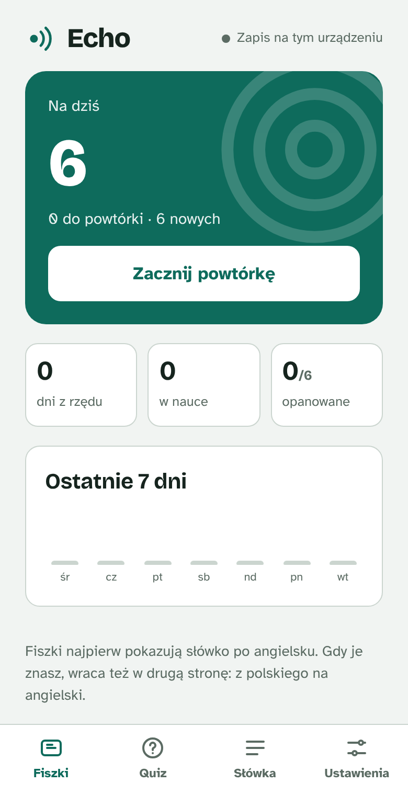
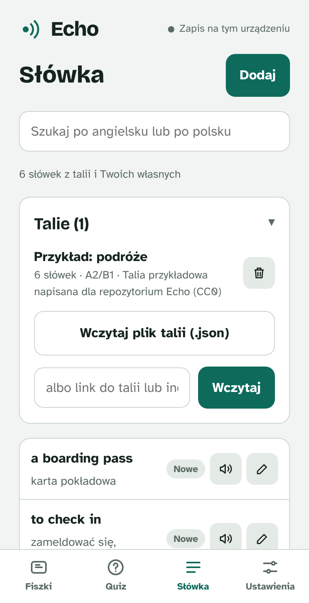

# Echo

An English vocabulary trainer for Polish speakers: spaced-repetition flashcards, quizzes and text-to-speech. It runs in the browser on phones and computers, with no installation and no account.

The app's interface is in Polish because it is built for Polish learners. Everything else in this repository (code, comments, documentation, issues and pull requests) is in English.

<p>
  
  
  
</p>

## Alpha (the new app)

The [`app/`](app/) directory holds the new version of Echo: one app for Windows, macOS, Android and iOS (React + TypeScript + Tauri 2) with two product lines, **Echo** for adults and **Echo Kids** for children. [`docs/architecture.md`](docs/architecture.md) describes how it is built and which decisions are open for review.

```sh
cd app
npm install
npm run dev          # browser, http://localhost:1420
npm test             # logic tests
npm run tauri dev    # desktop window (requires Rust)
```

The app bundles decks from the directory set in `ECHO_CONTENT_DIR` (default: [`examples/`](examples/)). The Windows installer and the Android APK are built on demand (macOS and iOS are disabled in CI for now): Actions → **Build** → Run workflow → choose a platform. The files are attached to the run as artifacts.

The rest of this README describes the original single-file version in `index.html`.

## Features

- **Spaced-repetition flashcards.** English → Polish first, and after the first successful review also Polish → English. Four grades (Again, Hard, Good, Easy; shown in Polish in the app) and a daily limit of new words.
- **A 10-question quiz:** choosing the translation in both directions, typing the English word with one typo tolerated, and filling the gap in a sentence. Wrong answers come back at the next review.
- **Text-to-speech:** the browser's system voices, British or American accent, adjustable speed.
- **Decks loaded from a file or a link**, plus your own words added and edited in the app.
- **Progress saved** in the browser, and, when running as a Claude artifact, in the user's account.

## Running

Open `index.html` in a browser. Serving the directory with a simple server is more convenient:

```sh
python3 -m http.server
# http://localhost:8000
```

On a phone, choose "Add to Home screen" in the browser menu so Echo behaves like an app.

## Decks

Echo ships without built-in words. Decks are loaded in **Słówka → Talie** (Words → Decks):

- **from a `.json` file** with a single deck or an array of decks,
- **from a link** to a deck or to a deck index (`echo-deck-index`). The server must allow cross-origin requests (CORS).

To try it out, load [`examples/travel.json`](examples/travel.json).

Loaded decks are saved together with progress. Loading a deck with the same `id` again updates it, and removing a deck does not erase progress.

### Deck format (`echo-deck`, version 1)

```json
{
  "format": "echo-deck",
  "version": 1,
  "id": "przyklad-podroze",
  "title": "Przykład: podróże",
  "source": "Własne notatki",
  "level": "A2/B1",
  "from": "en",
  "to": "pl",
  "cards": [
    {
      "id": "przyklad-podroze-01",
      "en": "a boarding pass",
      "pl": "karta pokładowa",
      "ex": "Please have your boarding pass ready at the gate.",
      "gap": "boarding pass",
      "note": "to board = wejść na pokład"
    }
  ]
}
```

| Field | Required | Meaning |
|---|---|---|
| `format`, `version` | yes | Always `"echo-deck"` and `1`. |
| `id` | yes | Deck identifier. Loading a deck with the same `id` again updates it. |
| `title`, `source`, `level` | no | Name, source and level shown in the deck list. |
| `cards[].id` | yes | Word identifier, unique across all decks. Progress is keyed by it, so never change it once a deck is shared. |
| `cards[].en`, `cards[].pl` | yes | The word or phrase and its translation. Separate variants with a slash, e.g. `a couch / a sofa`. |
| `cards[].ex` | no | Example sentence. |
| `cards[].gap` | no | Part of the example sentence hidden in the quiz. It must appear in the sentence. |
| `cards[].note` | no | Note shown after the answer is revealed. |

A deck index lists deck files relative to itself:

```json
{ "format": "echo-deck-index", "version": 1, "decks": [ { "id": "przyklad-podroze", "title": "Przykład: podróże", "file": "decks/travel.json", "count": 6 } ] }
```

Decks made from course materials and textbooks are usually protected by copyright. Do not add them to this repository: `.gitignore` excludes `.json` files outside `examples/` by default.

## Privacy

- Progress and decks are stored in the browser (`localStorage`) and, in Claude, in the user's account. The app does not send them anywhere else.
- Fonts load from Google Fonts, so the browser connects to Google's servers.
- Text-to-speech uses system voices. In some browsers (e.g. Chrome) certain voices run in the browser vendor's cloud.

## Structure

The original app is a single file, [`index.html`](index.html): HTML, CSS and JavaScript with no framework and no build step. The main parts of the script:

- `decks`: deck validation and loading,
- `storage`: saving state locally and to the Claude account,
- `SRS`: review scheduling (an SM-2 variant),
- `views`: the Flashcards, Quiz, Words and Settings screens.

## Contributing

See [CONTRIBUTING.md](CONTRIBUTING.md) for the repository conventions and [SECURITY.md](SECURITY.md) for reporting vulnerabilities.

## License

[MIT](LICENSE). `examples/travel.json` is additionally dedicated to the public domain under CC0 1.0. The MIT license covers this repository's code only: vocabulary decks loaded into the app keep their own rights. Third-party components and their licenses are listed in [NOTICE.md](NOTICE.md).
